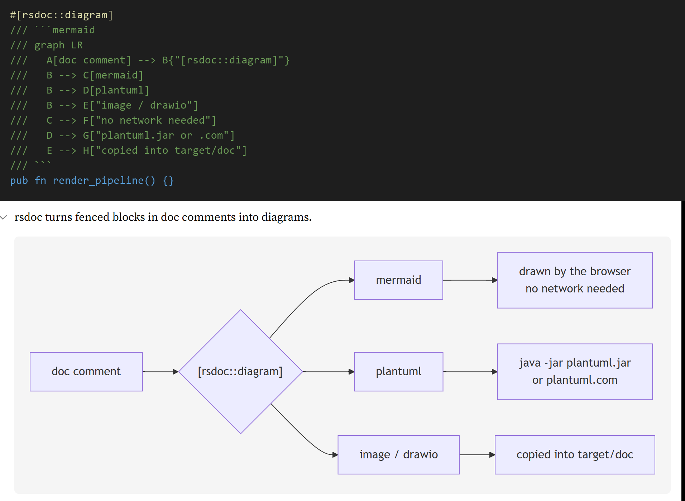
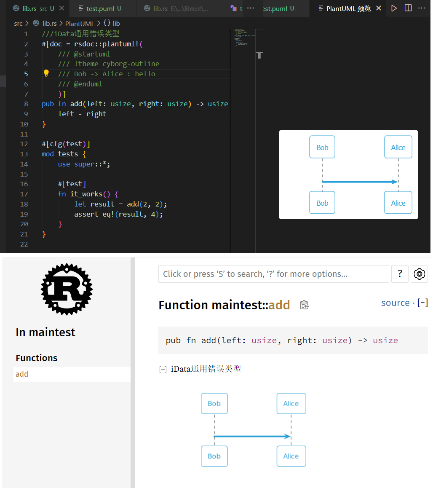

# rsdoc

Write a diagram in a doc comment, get an image in your rustdoc output.

Mermaid, PlantUML, drawio and plain images — one attribute, no server, and
Mermaid that renders with **no network access at all**.



## Quick start

```toml
[dependencies]
rsdoc = "0.4"
```

```ignore
#[rsdoc::diagram]
/// Pipeline overview:
///
/// ```mermaid
/// graph TD
///   A[Doc comment] --> B[proc-macro]
///   B --> C[SVG]
/// ```
pub fn pipeline() {}
```

`cargo doc` and the diagram is there. The `mermaid.js` engine ships inside the
crate and is copied into the output directory during the build, so the generated
documentation works on an air-gapped machine — no CDN, no server request.

*Requires Rust 1.71 or later.*

## What you can embed

| Fence | Needs at build time | Output |
|---|---|---|
| `mermaid` | nothing, the engine is bundled | SVG drawn by the browser |
| `plantuml` | a local jar, or network access | inline SVG |
| `image` | the file on disk | copied and referenced |
| `drawio` | a `.drawio.svg` export | copied and referenced |

Anything else in the doc comment — prose, lists, other code fences — is passed
through untouched.

## The `diagram` attribute

Annotate the item and write ordinary fenced blocks. This is the recommended form:
it reads like normal documentation, and your editor highlights the diagram source.

````ignore
#[rsdoc::diagram]
/// Pipeline overview:
///
/// ```mermaid
/// graph TD
///   A --> B
/// ```
///
/// ```drawio
/// diagrams/architecture.drawio.svg
/// ```
pub fn pipeline() {}
````

> The attribute is called `diagram`, not `mermaid`, because a proc-macro crate
> exports every macro into a single namespace: `#[rsdoc::mermaid]` would collide
> with the existing `rsdoc::mermaid!`.

### Diagrams in their own file

Large diagrams are easier to keep outside the source. Write a directive on its own
line and the file is read from the crate root:

````ignore
#[rsdoc::diagram]
/// Architecture overview:
///
/// include_mmd!("docs/diagrams/architecture.mmd")
///
/// include_puml!("docs/diagrams/sequence.puml")
pub fn architecture() {}
````

### Pinning a Mermaid theme

````ignore
#[rsdoc::diagram(theme = "forest")]
/// ```mermaid
/// graph TD
///   A --> B
/// ```
pub fn themed() {}
````

`theme` accepts any Mermaid palette — `default`, `dark`, `forest`, `neutral`,
`base`. A single block can override it by appending the theme to the fence, as in
a fence opening with `mermaid theme=neutral`. With neither, the diagram follows
rustdoc's light/dark setting.

## Mermaid

The attribute above is the easy path. The function-style macros do the same thing
when you need them, for instance inside a `#[doc]` on something that is not an
item:

```ignore
#[doc = rsdoc::mermaid!(
/// graph TD
///   A[Start] --> B{Done?}
///   B -->|yes| C[Ship it]
///   B -->|no| D[Fix]
)]
pub fn test_function() {}
```

```ignore
#[doc = rsdoc::mermaid_file!("diagrams/flow.mmd")]
```

The diagram is emitted as a `<pre class="mermaid">` block and drawn by the
browser. `mermaid.js` (v11) is copied to `target/doc/mermaid.min.js` during the
build, so the output renders with **no network access**: no CDN, no server
request, works offline and on an intranet.

## PlantUML

```ignore
#[doc = rsdoc::plantuml!(
/// @startuml
/// !theme cyborg-outline
/// Bob -> Alice : hello
/// @enduml
)]
pub fn test_function() {}
```

```ignore
#[doc = rsdoc::plantuml_file!("pumls/test.puml")]
```

By default these render through `plantuml.com`, so they need network access at
build time. To render locally, put a `plantuml.jar` next to `Cargo.toml` or point
`RSDOC_PLANTUML_JAR` at one — rsdoc then runs `java -jar plantuml.jar -tsvg
-pipe` and nothing leaves the machine. Rendered output is cached, so a rebuild
does not start the JVM again for a diagram that has not changed.



## Images and drawio

Attach any picture — PNG, JPEG or SVG:

```ignore
#[doc = rsdoc::image!("diagrams/schema.png")]
```

Control the size, the alt text and the caption:

```ignore
#[doc = rsdoc::image!("diagrams/arch.png", width = 600)]
#[doc = rsdoc::image!("diagrams/arch.png", width = "80%", alt = "System overview")]
#[doc = rsdoc::image!("diagrams/arch.png", caption = "Figure 1: system overview")]
```

The same options work inside a fence, one `key = value` per line:

````ignore
#[rsdoc::diagram]
/// ```image
/// diagrams/arch.png
/// width = 600
/// alt = System overview
/// caption = Figure 1: system overview
/// ```
pub fn architecture() {}
````

A `caption` turns the picture into a `<figure>` with a `<figcaption>`. Every
image is marked `loading="lazy"`, so a page with dozens of screenshots does not
fetch them all up front.

### drawio

`image!` works with drawio's *editable vector image* format. In drawio pick
`File > Export as > SVG` and tick **Include a copy of my diagram**; the suggested
file name then ends in `.drawio.svg`.

That single file plays both roles: browsers render it as an ordinary vector image,
and drawio reopens it as the original diagram, because the source XML is stored in
the SVG element's `content` attribute. There is no separate `.drawio` file to keep
in sync.

```ignore
#[doc = rsdoc::image!("diagrams/architecture.drawio.svg")]
```

rsdoc does not re-render `.drawio` sources — export again after changing a
diagram. To check that a file really carries its source:

```sh
grep -c "mxfile\|mxGraphModel" diagrams/architecture.drawio.svg
```

A result of `0` means the export was a plain image, so keep the `.drawio` file
alongside it.

## Document extras

Two macros that have nothing to do with diagrams, but make a crate page nicer.

### `badges!`

A one-line row of links built from your package metadata — nothing to keep in
sync by hand:

```ignore
#![doc = rsdoc::badges!()]
```

renders as:

```text
crates.io · docs.rs · source · v0.4.2 · MIT OR Apache-2.0
```

Links whose metadata is missing are skipped, so a crate without a `repository`
field simply gets no source link. The version comes from `Cargo.toml`, so it never
goes stale.

### `notice!`

A coloured callout for deprecation or migration notices:

```ignore
#[doc = rsdoc::notice!(warning, "This crate is unmaintained. Use `newcrate` instead.")]
```

Three levels — `info`, `warning` and `danger` — styled inline, so they look the
same in every rustdoc theme without shipping a stylesheet. Backticks in the body
become `<code>`; everything else is escaped.

## Diagnostics

### Mermaid syntax check

Mermaid is drawn by the browser, so a syntax error would otherwise stay invisible
until someone opens the documentation. rsdoc runs a lightweight structural check
during the build and reports what it finds:

```text
warning: rsdoc failed on `grap TD A --> B` (mermaid):
         unrecognised diagram type `grap`, did you mean `graph`?
warning: rsdoc failed on `graph A --> B` (mermaid):
         `graph` needs a direction (TD, TB, BT, LR or RL), found ``
warning: rsdoc failed on `graph TD A[Start --> B[Done]` (mermaid):
         line 2: `[` is never closed — `A[Start --> B[Done]`
```

It covers a misspelled or unsupported diagram type, a `graph` with no direction,
unbalanced brackets or quotes, and a `subgraph` without `end`. Problems are
reported but never block rendering.

This is deliberately not a full parser — it will not tell you that a layout looks
wrong, only that the source cannot be right.

### For scripts and AI agents

Set `RSDOC_JSON=1` and every diagnostic becomes one JSON object per line instead
of prose:

```json
{"tool":"rsdoc","level":"error","kind":"plantuml","message":"syntax error at line 3: Syntax Error?","preview":"@startuml Alice -> Bob : hello ThisLineIsNotVali…"}
```

Every failure also quotes the diagram that broke. A `#[doc]` expansion carries no
usable source location on stable Rust, so in a crate with dozens of diagrams that
excerpt is the only way to tell which one failed.

## How it compares

Two other crates solve overlapping problems. An honest comparison:

|  | rsdoc | [aquamarine] | [simple-mermaid] |
|---|---|---|---|
| Maintenance | active | **unmaintained** | active |
| Mermaid | bundled, renders offline | bundled | loaded from a CDN |
| PlantUML | local jar or plantuml.com | — | — |
| Drawio / images | ✓ | — | — |
| Inline code block | ✓ | ✓ | — (files only) |
| Diagram from file | `include_mmd!` / `include_puml!` | `include_mmd!` | ✓ |
| Dependencies | six | several | **zero** |

**Use simple-mermaid** if Mermaid from files is all you need and you want zero
dependencies. It is smaller, and it does one thing well.

**Use rsdoc** if you need PlantUML, drawio, diagrams written inline, or Mermaid
that renders with no network access at all — for intranet docs, archives, or
anything that has to survive without a CDN.

## Tips

- These macros expand during **every** build, not only `cargo doc`, because
  `#[doc = ...]` is a regular attribute. Rendered diagrams are cached in
  `target/rsdoc-cache/<sha1>.svg`; a rebuild reads the cache instead of rendering
  again. Delete that directory to force a refresh.
- Wrap a call in `#[cfg_attr(doc, ...)]` if you only want the diagram in
  documentation builds.
- The bundled `mermaid.js` adds roughly 3.4 MiB to the crate. It is written to the
  documentation root once per build tree, not embedded into every page. It does
  **not** end up in your binary — proc-macro code runs at compile time only.

## How asset paths are resolved

rsdoc deliberately does **not** hard-code a relative prefix such as
`../../images/`. The depth of a rustdoc page depends on where the item sits in the
module tree:

| page | path back to the doc root |
| --- | --- |
| `crate/fn.x.html` | `../` |
| `crate/mod/fn.x.html` | `../../` |
| `crate/a/b/fn.x.html` | `../../../` |

Any single fixed value is therefore wrong for some pages. Instead, every generated
element carries a `data-rsdoc-src` attribute and a small bootstrap script fills in
the real `src` at load time. The root it prepends is derived from rustdoc's own
asset reference, which rustdoc already computes correctly per page:

1. `static.files/` — rustdoc 1.65 and later
2. `rustdoc.css` at the doc root — older releases
3. the `Source` link, which always points at `<root>/src/…`

If none of them can be found — for instance if a future rustdoc switches to
absolute asset URLs — the bootstrap falls back to probing `../`, `../../`,
`../../../` and `./` until one resolves. A working anchor costs exactly one
request, so probing only fires when the page structure has really changed.

The output directory itself is located from `CARGO_TARGET_DIR`, or by walking
upwards from `CARGO_MANIFEST_DIR` until a `target/` directory appears, so
workspaces and custom target directories work too.

Wide diagrams and images are constrained with `max-width: 100%`, so nothing pushes
the page into a horizontal scrollbar.

## License

MIT OR Apache-2.0

[aquamarine]: https://crates.io/crates/aquamarine
[simple-mermaid]: https://crates.io/crates/simple-mermaid
